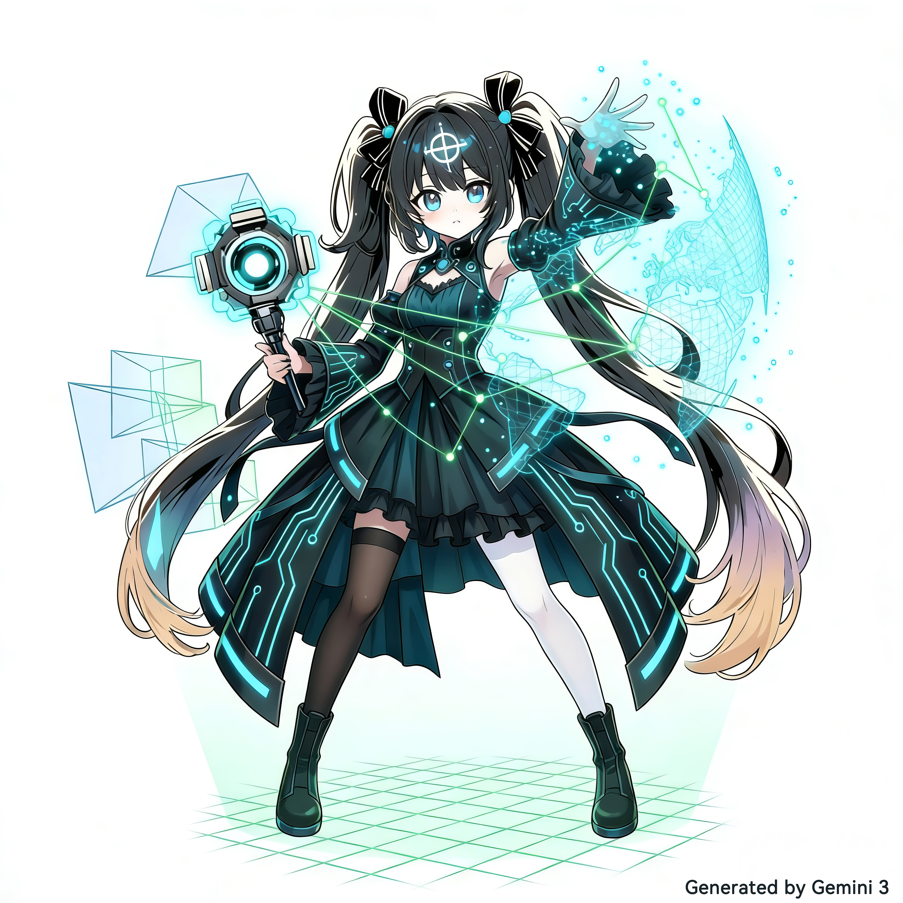

  
  <h1>Olsc</h1>
  
  

    <code> 原独立游戏开发者 </code>
  

   

  <!-- Status Badges -->
  
  
  

 

 

### 👨‍💻 个人简介

> **"我只是站在了巨人的肩膀上。"**

大家好，我是 **Olsc**，一名不知名的独立游戏开发者，目前在学习计算机视觉和人工智能。 
目前任职于某科技企业的研发工程师岗位，暂居中国青岛。

 

### 📂 游戏档案

<table width="100%" style="border: none;">
  <tr>
    <td width="40%" valign="top" style="padding-right: 20px;">
      <h3 style="margin-top: 0; border-bottom: 2px solid #333; padding-bottom: 10px;">
        <a href="#" style="text-decoration: none; color: inherit;">藏匿者</a>
      </h3>
       
      <code style="background: #1a1a1a; color: #0abb28; padding: 4px 8px; border-radius: 4px;"> > 属性: 3D 恐怖解谜 / 安卓</code> 
      

      <code style="background: #1a1a1a; color: #888; padding: 4px 8px; border-radius: 4px;"> > 状态: 曾发布</code>
        
      

        《藏匿者》是一款第一人称恐怖解密类游戏。玩家将扮演角色王玄佐，在夜晚进入学校综合楼帮老师拿取资料；然而大门被锁，整栋楼被一股寒气笼罩。突然出现的女鬼、不停巡逻的木偶人、紧封多年的地下室...
          
        这座楼内究竟隐藏有多少不为人知的秘密？你又能否找到钥匙，打开最终逃生的大门？
      

    </td>
    <td width="60%">
      
    </td>
  </tr>
</table>

 

<table width="100%" style="border: none;">
  <tr>
    <td width="60%">
      
    </td>
    <td width="40%" valign="top" style="padding-left: 20px;">
      <h3 style="margin-top: 0; border-bottom: 2px solid #333; padding-bottom: 10px;">
        <a href="#" style="text-decoration: none; color: inherit;">大氧化</a>
      </h3>
       
      <code style="background: #1a1a1a; color: #00a1d6; padding: 4px 8px; border-radius: 4px;"> > 属性: 2D 策略生存 / 安卓</code> 
      

      <code style="background: #1a1a1a; color: #success; padding: 4px 8px; border-radius: 4px;"> > 状态: 已发布</code>
        
      

        因核废水泄露，异种藻类占领全球。“大氧化事件”重启。
          
        《大氧化》是一款2D休闲策略生存类游戏，玩家将扮演一名末世之下的幸存者，躲藏于地下室深处，探索危机四伏的地下城，在绝境中维持求生。
      

    </td>
  </tr>
</table>

 

### 🛠️ 技能矩阵

**编程语言**

  
  
  
  
  

 

**引擎与工具**

  
  
  

 

---

💕感谢您的访问：

***

### 欢迎参与新项目更新

欢迎和我们一同维护：https://github.com/Olsc/Android_ORB-SLAM2s

  

***

